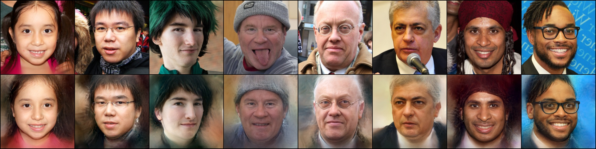

# Single-image 3D head reconstruction with GAN inversion

**Andrew Hung and Ho Yin Koo · HKUST Computer Science final-year project · 2025–2026**  
Supervisor: Prof. Dan Xu

Can an encoder recover a 3D Gaussian head from one portrait using a pretrained generator? We tested five ways to invert or refine a head representation. Direct latent inversion recovered coarse facial structure. Predicting UV corrections changed the test scores only slightly, while stacking a second set of Gaussians often duplicated facial features.

*Direct inversion, final report Fig. 16. Each column is one example. The top row contains the input portraits and the bottom row contains their reconstructions. Notice the change in expression in the fourth column and the loss of detail around glasses in the fifth.*

## How it works

An encoder maps a portrait to a **W+ latent code**. The pretrained **GGHead** generator decodes that code into 3D Gaussians, which a differentiable rasterizer projects into an image from a chosen camera. Reconstruction losses train the encoder to recover a code that reproduces the portrait. We trained on FFHQ and evaluated generalization on CelebA-HQ.

## What the comparison showed

| Method | PSNR ↑ (dB) | SSIM ↑ | LPIPS ↓ |
| --- | ---: | ---: | ---: |
| Direct latent inversion | **14.77** | **0.500** | **0.326** |
| UV refinement | 14.60 | 0.484 | 0.340 |
| Gaussian stacking | 11.80 | 0.360 | 0.480 |

*Test-set results from Table 6 of the final report. Arrows show the preferred direction.*

Direct inversion led these three methods on every metric. UV refinement trailed it by only 0.17 dB PSNR. Stacking trailed it by 2.97 dB, and its outputs often showed doubled eyes or mouths. The direct method also had limitations: its test PSNR was 3.33 dB below its training-set result, and it sometimes lost expression or identity details.

[See the refinement examples, all five architectures, and additional experiments →](experiments.md)

## Contributions

**Andrew Hung (Ming Kin Hung)** led encoder design, training-pipeline design, and testing of the encoder, decoder, and editing modules. **Ho Yin Koo** led decoder and editing-module design, model training, and evaluation. Both contributed to the literature review. These roles follow the team's division of work in Table 9 of the final report.

## Project and credits

This repository presents the experiments and figures from the team's *Generalizable Single-view 3D Head Avatar Generation System* final report. The generator builds on [GGHead by Kirschstein et al.](https://tobias-kirschstein.github.io/gghead/). The reported comparisons concern the team's inversion experiments. Reconstruction metrics measure agreement in the evaluated view and do not establish accuracy of unseen geometry.
