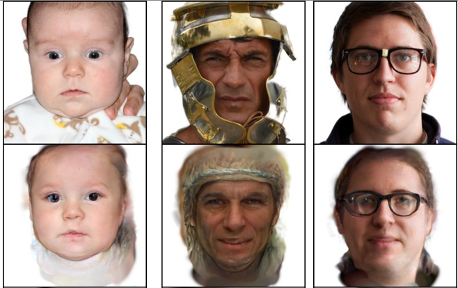
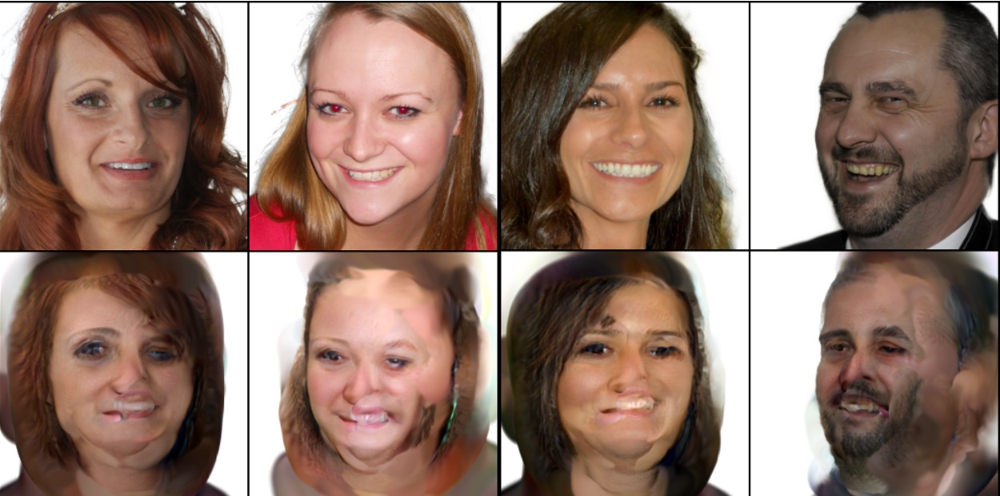

# Experiments

[Back to project overview](README.md)

## Where to apply the correction

| Pipeline | Design | What happened |
| --- | --- | --- |
| 1. Direct inversion | Predict a W+ code for pretrained GGHead. | Established the baseline. Coarse features survived more consistently than expression and fine detail. |
| 2. UV refinement | Predict corrections to Gaussian attributes in UV space. | Face and hair boundaries remained difficult to align. |
| 3. Gaussian stacking | Render a second set of Gaussians alongside the first. | Overlapping structures produced visible ghosting. |
| 4. Dual encoders | Fuse latent predictions from two encoders. | Training did not converge reliably. |
| 5. Tri-plane decoding | Decode an intermediate tri-plane representation into Gaussians. | Fine-tuning improved the hybrid model, with different tradeoffs across metrics. |

## Refinement examples

*Figure 17. Top: input. Bottom: UV refinement. Check the alignment of the face contour and hair.*

*Figure 18. Top: input. Bottom: Gaussian stacking. The extra Gaussian set can produce a second outline or duplicate facial features.*

## Refinement ablations

| Setting (Table 6) | PSNR ↑ | SSIM ↑ | LPIPS ↓ |
| --- | ---: | ---: | ---: |
| Direct inversion | 14.77 | 0.500 | 0.326 |
| UV refinement | 14.60 | 0.484 | 0.340 |
| UV refinement with transformer UVNet | 13.32 | 0.421 | 0.398 |
| UV refinement with generator fine-tuning | 13.89 | 0.462 | 0.377 |
| Gaussian stacking | 11.80 | 0.360 | 0.480 |

## Tri-plane decoder experiment

| Setting (Table 7) | PSNR ↑ | SSIM ↑ | LPIPS ↓ |
| --- | ---: | ---: | ---: |
| Hybrid without training | 8.02 | 0.044 | 0.417 |
| Fine-tune Gaussian decoder only | 13.90 | 0.385 | 0.347 |
| Fine-tune GOAE only | 14.67 | 0.423 | **0.306** |
| Direct-inversion reference | **14.77** | **0.500** | 0.326 |

Fine-tuning GOAE gave the lowest perceptual distance in this comparison, while direct inversion retained the highest PSNR and SSIM. A claim that one method won on every metric across all five pipelines would miss this distinction.

## Interpretation

The project tested whether adding capacity at the latent, UV, or Gaussian level would preserve more of the input portrait. Under the evaluated settings, extra capacity alone did not consistently improve reconstruction. The stacking examples suggest that explicitly aligning a second set of Gaussians would be a useful follow-up experiment. The reported tests do not isolate alignment as the sole cause.

Source: HKUST DAN4 final project report, §3.7, Tables 4–7 and Figures 16–18.
